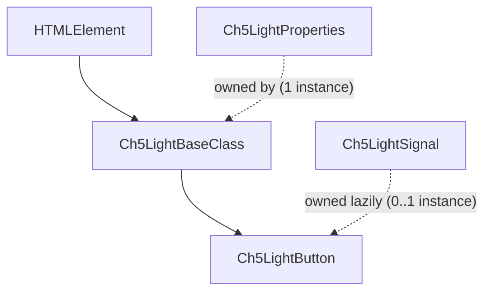
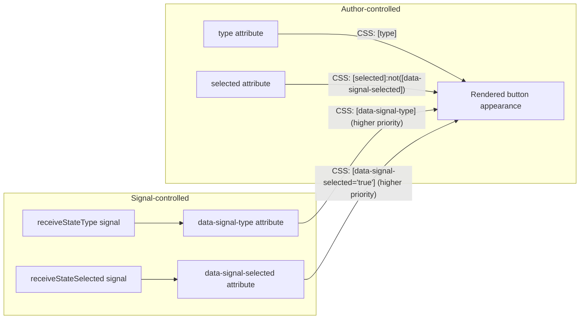

# `ch5-light-button` — Design & Maintenance Reference

> **Living document.** This file is the source of truth for how `Ch5LightButton`
> (and the `Ch5LightBaseClass` it extends) is designed, why it is designed that
> way, and how to extend it safely. Whenever you change
> [ch5-light-button.ts](ch5-light-button.ts) or
> [ch5-light-base-class.ts](../ch5-light-base/ch5-light-base-class.ts) in a way
> that affects behavior, public API, or the design rules below, **update this
> file in the same change**. Treat stale sections here as a bug.

---

## 1. What this component is

`ch5-light-button` (`Ch5LightButton`) is a **stripped-down, high-density
alternative to `ch5-button`**. It is built for screens that need hundreds or
thousands of simultaneous button instances (e.g. matrix/grid UIs) where the
full `Ch5Common` / `Ch5BaseClass` machinery (lodash, `Ch5Properties`,
`MutationObserver`, full signal subscription framework, ripple/press
animations, etc.) is too heavy per-instance.

It intentionally supports a **small subset** of `ch5-button`'s features:

| Feature | Supported? |
|---|---|
| `label` | ✅ |
| `iconClass` / `iconUrl` | ✅ (mutually exclusive, `iconUrl` wins) |
| `backgroundImageUrl` | ✅ |
| `type` (static, CSS-only styling) | ✅ (inherited via CSS attribute selector, not JS) |
| `selected` (static, CSS-only styling) | ✅ (inherited via CSS attribute selector, not JS) |
| `receiveStateType` (signal-driven type) | ✅ |
| `receiveStateSelected` (signal-driven selected) | ✅ |
| `receiveStateLabel` (signal-driven label) | ✅ |
| `receiveStateIconClass` (signal-driven icon class) | ✅ |
| `receiveStateIconUrl` (signal-driven icon URL) | ✅ |
| `receiveStateBackgroundImageUrl` (signal-driven background image URL) | ✅ |
| `show` / `noshowtype` | ✅ (via `Ch5LightBaseClass`) |
| `disabled` | ✅ (styled purely via CSS `[disabled]`, no JS) |
| Press/click signal emission, ripple, gestures, long-press, repeat digital | ❌ (out of scope — use `ch5-button` if you need these) |
| `customClass` / `customStyle` / template vars | ❌ |

If a consumer needs anything not in the "supported" list, they should reach
for `ch5-button` instead of extending this component's scope.

---

## 2. Class hierarchy



- **[Ch5LightBaseClass](../ch5-light-base/ch5-light-base-class.ts)** — abstract
  base for the whole "light" family. Extends `HTMLElement` directly (no
  `Ch5Common`). Owns the `Ch5LightProperties` store and handles `show` /
  `noshowtype` (the only attributes common to every light component).
- **[Ch5LightProperties](../ch5-light-base/ch5-light-properties.ts)** — a
  minimal, dependency-free key/value store with change-detection (`set` only
  invokes its callback when the value actually changed). One instance is
  created by `Ch5LightBaseClass` and **shared** — derived classes call
  `_ch5Properties.add(...)` to register their own attributes on the *same*
  store instead of allocating a second one.
- **[Ch5LightSignal](../ch5-light-base/ch5-light-signal.ts)** — a thin,
  reusable subscribe/unsubscribe wrapper around `Ch5Signal` /
  `Ch5SignalFactory` (the same signal bus the rest of the library uses).
  Created **lazily**, only for buttons that actually use a
  `receiveState*` attribute.
- **Ch5LightButton** — this component. Owns its own DOM (`<button>` +
  optional `<i>` icon + optional `<span>` label) and wires the
  `receiveStateType` / `receiveStateSelected` signals.

### Why not extend `Ch5Common` / `Ch5BaseClass`?

Documented in [ch5-light-base-class.ts](../ch5-light-base/ch5-light-base-class.ts):
no lodash, no `MutationObserver`, no debounce timers, no signal machinery in
the base class itself. The per-instance footprint is close to a bare custom
element. See §8 for the specific GC/allocation rules this imposes on derived
components.

---

## 3. File map

| File | Responsibility |
|---|---|
| [ch5-light-button.ts](ch5-light-button.ts) | This component: DOM creation, attribute wiring, signal wiring |
| [index.ts](index.ts) | Barrel export (`export * from './ch5-light-button'`) |
| [../ch5-light-base/ch5-light-base-class.ts](../ch5-light-base/ch5-light-base-class.ts) | Abstract base: `show` / `noshowtype`, lifecycle contract |
| [../ch5-light-base/ch5-light-properties.ts](../ch5-light-base/ch5-light-properties.ts) | Shared property store (get/set/add, change-detection only) |
| [../ch5-light-base/ch5-light-signal.ts](../ch5-light-base/ch5-light-signal.ts) | Shared signal subscribe/unsubscribe helper |
| `_light-button-icon-position.scss` *(theme repo — not in this workspace)* | CSS `order` rules that position the icon relative to the label |

---

## 4. Public API

### Attributes / properties

| Attribute (lowercase) | Property (camelCase) | Type | Default | Notes |
|---|---|---|---|---|
| `label` | `label` | `string` | `''` | Rendered in a lazily-created `<span class="ch5-light-button--label">` |
| `iconclass` | `iconClass` | `string` | `''` | Font-icon class(es); ignored when `iconUrl` is set |
| `iconurl` | `iconUrl` | `string` | `''` | Renders icon as a background image; takes priority over `iconClass` |
| `backgroundimageurl` | `backgroundImageUrl` | `string` | `''` | Applied as inline `background-image` on the `<button>` |
| `type` | *(none — static attribute, CSS-only)* | enum | `default` | One of `Ch5LightButton.TYPES`. Styled purely via CSS attribute selector `[type]`. No JS reads/writes it. |
| `selected` | *(none — static attribute, CSS-only)* | boolean | — | Styled purely via CSS attribute selector `[selected]`. No JS reads/writes it. |
| `receivestatetype` | `receiveStateType` | `string` (signal name) | `''` | See §6 |
| `receivestateselected` | `receiveStateSelected` | `string` (signal name) | `''` | See §6 |
| `receivestatelabel` | `receiveStateLabel` | `string` (signal name) | `''` | JS-rendered signal — **write-through** into the `label` slot. See §6.5 |
| `receivestateiconclass` | `receiveStateIconClass` | `string` (signal name) | `''` | JS-rendered signal — **write-through** into the `iconClass` slot, not a `data-signal-*` channel. See §6.5 |
| `receivestateiconurl` | `receiveStateIconUrl` | `string` (signal name) | `''` | JS-rendered signal — **write-through** into the `iconUrl` slot. See §6.5 |
| `receivestatebackgroundimageurl` | `receiveStateBackgroundImageUrl` | `string` (signal name) | `''` | JS-rendered signal — **write-through** into the `backgroundImageUrl` slot; also reflects the `backgroundimageurl` host attribute so the fill-type CSS matches. See §6.5 |
| `show` | `show` | `boolean` | `true` | Inherited from `Ch5LightBaseClass` |
| `noshowtype` | `noshowType` | `'display'\|'visibility'\|'remove'` | `'display'` | Inherited from `Ch5LightBaseClass` |
| `disabled` | *(none)* | boolean | — | **Not handled in JS at all** — styled entirely via CSS `[disabled]` |

### Static constants

- `ELEMENT_NAME = 'ch5-light-button'`
- `PRIMARY_CSS_CLASS = 'ch5-light-button'`
- `TYPES` — allowed `type` values: `['default', 'primary', 'info', 'text', 'danger', 'warning', 'success', 'secondary']`
- `SIGNAL_ATTRIBUTE_TYPE = 'data-signal-type'` — the styling channel written by `receiveStateType`
- `SIGNAL_ATTRIBUTE_SELECTED = 'data-signal-selected'` — the styling channel written by `receiveStateSelected`

### Static methods

- `registerCustomElement()` — idempotent `customElements.define(...)` guard.
- `observedAttributes` — merges `Ch5LightBaseClass.LIGHT_BASE_OBSERVED_ATTRIBUTES`
  (`show`, `noshowtype`) with this component's own `OBSERVED_ATTRIBUTES`.

---

## 5. The static `type` / `selected` vs. signal-driven channels

This is the single most important design decision in this component and is
easy to get wrong when extending it, so it gets its own section.

`type` and `selected` are **plain static HTML attributes** with **no JS
involvement at all** — no getter/setter, no entry in `_ch5Properties`, no
`attributeChangedCallback` case. They are styled purely by the theme SCSS via
CSS attribute selectors (`[type]`, `[selected]`).

`receiveStateType` / `receiveStateSelected` do **not** write to `type` /
`selected`. Instead they write to **separate** attributes:
`data-signal-type` / `data-signal-selected`. The theme SCSS gives the
`data-signal-*` selectors **priority** over the plain `[type]` / `[selected]`
selectors (`selected`'s static selector is additionally guarded with
`:not([data-signal-selected])`).



**Why:** this means a signal always wins over the author's static markup,
*even if the author changes `type`/`selected` at runtime*, with **zero JS
render/observe step** — the cascade does all the work. It also means
signal-free buttons pay nothing (no attribute is ever written).

**Rule for extension:** if you add another visual property that can be
signal-driven, the pattern depends on **how that property is styled**:

- **Pure-CSS attributes** (like `type` / `selected`) — follow the pattern
  above: a dedicated `data-signal-*` shadow attribute with SCSS priority,
  never overwrite the author's own attribute.
- **JS-rendered content** (like `iconClass` / `iconUrl` / `backgroundImageUrl`)
  — there is no static CSS channel to override, so use the simpler
  **write-through** approach (§6.5): write the signal value straight into the
  same slot the static attribute uses and re-render. See §6.5 for the full
  rationale and the one extra step `backgroundImageUrl` needs for its
  fill-type CSS.

### 5.1 Performance & correctness: shadow attribute vs. a directly signal-writable attribute

It's tempting to simplify `type`/`selected` by dropping the separate
`data-signal-*` channel and just having the signal overwrite `type`/`selected`
directly (the way `label`/`iconClass`/`iconUrl` do, per §6.5). **Don't** — it
is both slower and less correct than the shadow-channel design above.

**Performance.** `data-signal-type`/`data-signal-selected` are **not** in
`OBSERVED_ATTRIBUTES`, so `this.setAttribute(SIGNAL_ATTRIBUTE_TYPE, type)`
costs exactly one native DOM write (+ the resulting style/layout
invalidation) — nothing else. The browser only invokes
`attributeChangedCallback` for attributes listed in the static
`observedAttributes` getter. If `type` were the signal's target instead, it
would have to be observed (so author markup like `type="danger"` still
works), and the signal handler would need `this.setAttribute('type', value)`
to keep the DOM attribute in sync for the `[type]` CSS selector. Because
`type` would now be observed, that `setAttribute` call **re-enters
`attributeChangedCallback` synchronously** on every signal tick — an extra
switch-dispatch → setter call → `_ch5Properties` equality check → possible
`onChange`, all before the original call even returns. This exact extra round
trip already happens today for `receiveStateBackgroundImageUrl`, which
reflects into the **observed** `backgroundimageurl` attribute for CSS reasons
(§6.5) — harmless there because the equality check makes the second pass a
no-op, but it's real, avoidable overhead that `type`/`selected` don't pay by
staying off `OBSERVED_ATTRIBUTES` entirely.

**Correctness.** This is the more important difference. With the shadow
channel, `[data-signal-type]` beats `[type]` **structurally**, via CSS
specificity/rule order, re-evaluated on every style recalc regardless of what
`type` currently holds or when it was last written. So if app code does
`button.type = 'danger'` while a signal is active, **nothing visually
changes** — there is no race, no "last writer wins" ambiguity, no way to
misuse the API and get it wrong.

---

## 6. Signal wiring deep dive (`receiveStateType` / `receiveStateSelected` / `receiveStateLabel` / `receiveStateIconClass` / `receiveStateIconUrl` / `receiveStateBackgroundImageUrl`)

### 6.1 Storage: `_ch5Properties`, not bespoke fields

The signal **names** (`receiveStateType`, `receiveStateSelected`) are
registered in the shared `_ch5Properties` store in the constructor, exactly
like `label` / `iconClass` / `iconUrl` / `backgroundImageUrl`:

```ts
this._ch5Properties.add([
    { name: 'label', default: '', type: 'string' },
    { name: 'iconClass', default: '', type: 'string' },
    { name: 'iconUrl', default: '', type: 'string' },
    { name: 'backgroundImageUrl', default: '', type: 'string' },
    { name: 'receiveStateType', default: '', type: 'string' },
    { name: 'receiveStateSelected', default: '', type: 'string' },
    { name: 'receiveStateLabel', default: '', type: 'string' },
    { name: 'receiveStateIconClass', default: '', type: 'string' },
    { name: 'receiveStateIconUrl', default: '', type: 'string' },
    { name: 'receiveStateBackgroundImageUrl', default: '', type: 'string' }
]);
```

This gets the same equality short-circuit as every other property: setting
the same signal name twice is a no-op.

### 6.2 Why the setters look slightly different from `label`/`iconClass`

`handleReceiveStateType` needs the **previous** signal name, in order to
unsubscribe it before subscribing to the new one — unlike `handleLabel`/
`handleIcon`, which only ever need the **current** value. `Ch5LightProperties`
is the only place that holds that previous value at the right moment (right
before it overwrites `_values[name]`), so rather than have every caller
re-capture it in its own field, `Ch5LightProperties.set()` **hands the old
value straight to `onChange` as a parameter**:

```ts
// ch5-light-properties.ts
public set<T extends boolean | string | number>(name: string, value: T, onChange?: (oldValue: T) => void): void {
    const currentValue = this._values[name];
    if (currentValue === value) { return; }
    // ...
    this._values[name] = nextValue;
    if (onChange) {
        onChange(currentValue as T); // <-- the value that was in effect a moment ago
    }
}
```

Callers that don't need the old value (`label`, `iconClass`, `show`, ...)
simply keep using a zero-arg cached callback (`() => this.handleLabel()`) —
TypeScript allows a function with fewer declared parameters to satisfy a
callback type that declares more, so this is a fully backward-compatible
addition to the shared store. `receiveStateType`/`receiveStateSelected` are
the only current consumers that use the parameter:

```ts
// Class field, allocated ONCE per instance, exactly like _onLabelChange:
private readonly _onReceiveStateTypeChange =
    (oldSignalName: string) => this.handleReceiveStateType(oldSignalName);

public set receiveStateType(value: string) {
    this._ch5Properties.set<string>('receiveStateType', value ?? '', this._onReceiveStateTypeChange);
}
```

No `_pendingOld*` field, no per-call closure — these setters are now
identical in shape and cost to `label`/`iconClass` (see §8.3). An earlier
version of this code captured the old value in a setter-local `const` handed
to an inline arrow (allocates a closure per call), then a version after that
captured it in a dedicated `_pendingOld*` plain field read by a cached
callback (no allocation, but one extra field per signal). Moving the
old-value handoff into `Ch5LightProperties.set()` itself removes even that
field, since the store already had the value — it just wasn't exposing it.


### 6.3 Subscribe / unsubscribe lifecycle

```mermaid
sequenceDiagram
    participant Attr as attributeChangedCallback
    participant Setter as receiveStateType setter
    participant Store as _ch5Properties
    participant Callback as _onReceiveStateTypeChange (cached)
    participant Handler as handleReceiveStateType
    participant Signals as Ch5LightSignal (_signals)
    participant Bus as Ch5SignalFactory / Ch5Signal

    Attr->>Setter: receivestatetype changed
    Setter->>Store: set('receiveStateType', newValue, _onReceiveStateTypeChange)
    Store->>Store: oldValue = values['receiveStateType']; values['receiveStateType'] = newValue
    Store->>Callback: onChange(oldValue)
    Callback->>Handler: handleReceiveStateType(oldValue)
    Handler->>Signals: clearSignalSubscription(oldValue)
    Signals->>Bus: unsubscribe(oldValue) [if any]
    alt newValue non-empty AND isConnected
        Handler->>Handler: subscribeReceiveStateType()
        Handler->>Signals: subscribeSignal(newValue, 'string', applySignalType)
        Signals->>Bus: subscribe(newValue) -> onValue callback
    else newValue empty
        Handler->>Handler: clearSignalChannel('data-signal-type')
    end
```

Key lifecycle guarantees:

- **`connectedCallback`** unconditionally calls `subscribeReceiveStateType()`
  / `subscribeReceiveStateSelected()` every time (first connect *and* every
  reconnect). Each is a no-op if the name is empty or already subscribed
  (`Ch5LightSignal.isSubscribedTo`), so this is safe to call repeatedly.
- **`disconnectedCallback`** calls `clearSignalSubscription(...)` for both
  signal names, releasing the underlying `Ch5Signal` subscription. The signal
  **name** is preserved (it lives in `_ch5Properties`, untouched by
  disconnect), so a later reconnect transparently re-subscribes.
- **No leak**: `Ch5LightSignal.unsubscribe()` → `Ch5Signal.unsubscribe(subKey)`
  calls the real rxjs `Subscription.unsubscribe()` and deletes the map entry
  — the closure capturing `this` is fully released, so a disconnected
  instance is not kept alive by the signal bus.
- `_signals` (the `Ch5LightSignal` instance) is created **lazily** — buttons
  that never set a `receiveState*` attribute never allocate it.

### 6.4 Applying a signal value

`applySignalType(value)` / `applySignalSelected(value)` are the `onValue`
callbacks passed to `subscribeSignal`. They are the **only** place that
writes `data-signal-type` / `data-signal-selected`:

- `applySignalType`: validates `value` against `Ch5LightButton.TYPES`,
  falling back to `TYPES[0]` (`'default'`) for unknown values (mirrors
  `ch5-button`'s behavior).
- `applySignalSelected`: writes `"true"`/`"false"` as a **string** — the
  attribute is always present once a signal is subscribed (never removed),
  because `"false"` is meaningfully different from "no signal" (it forces
  *not selected*, whereas removing the attribute lets the static `selected`
  attribute regain control).

### 6.5 The JS-rendered signals — `receiveStateLabel` / `receiveStateIconClass` / `receiveStateIconUrl` / `receiveStateBackgroundImageUrl` (write-through)

`type` and `selected` are **pure-CSS** attributes, so their signals need the
separate `data-signal-*` channel described in §5. `label`, `iconClass`,
`iconUrl`, and `backgroundImageUrl` are **rendered in JS** (§7) — there is no
static CSS channel to override — so their signals use the simpler
**write-through** pattern instead (the same approach as `ch5-animation`'s
`startAnimating`):

```ts
private applySignalLabel(value: string): void {
    this.label = value ?? '';        // straight into the shared slot -> handleLabel()
}
private applySignalIconClass(value: string): void {
    this.iconClass = value ?? '';    // straight into the shared slot -> handleIcon()
}
private applySignalIconUrl(value: string): void {
    this.iconUrl = value ?? '';       // straight into the shared slot -> handleIcon()
}
```

The signal value is written **straight into the same property slot** the
static attribute uses, which runs the cached `_onLabelChange` / `_onIconChange` /
`_onBackgroundImageChange` callback and re-renders through the normal
pipeline. The store's equality short-circuit still skips redundant re-renders.

**Why this is safe (the platform contract):** at runtime, **only the signal**
updates these values — the static `label` / `iconclass` / `iconurl` / `backgroundimageurl`
are set once at design time and never re-written live. So the signal is
always the last writer and therefore always wins, with no separate channel
and no extra CSS. (Removing a signal at runtime is a design-time change — a
fresh instance renders the static value — so there is no runtime override to
unwind; the last signal value simply remains in the slot.)

**The one exception — `receiveStateBackgroundImageUrl` reflects the host
attribute.** The `backgroundimageurlfilltype` CSS is scoped to
`ch5-light-button[backgroundimageurl]` (a perf scope so buttons with no
background image are never matched). A static author sets that attribute in
markup, but a signal-driven URL would leave the host without it, so the fill
type would be ignored (every mode looks identical). `applySignalBackgroundImageUrl`
therefore reflects the attribute onto the host and removes it when the signal
clears:

```ts
private applySignalBackgroundImageUrl(value: string): void {
    const url = value ?? '';
    if (url) { this.setAttribute('backgroundimageurl', url); }
    else { this.removeAttribute('backgroundimageurl'); }
    this.backgroundImageUrl = url;
}
```

Re-entering `attributeChangedCallback` → the setter is harmless: the store's
equality short-circuit stops any re-render loop. `receiveStateIconUrl` needs
**no** equivalent step because the `iconurlfilltype` CSS is scoped to
`[iconurlfilltype]` and the JS-created `--img` element, **not** to the
`[iconurl]` attribute — so it already matches for signal-driven URLs.

Priority is unchanged: in `handleIcon()`, `iconUrl` still wins over
`iconClass` (whether static or signal-driven), matching `ch5-button`.

---

## 7. Rendering pipeline (label / icon / background image)

### 7.1 DOM shape

```
<ch5-light-button class="ch5-light-button" data-signal-type="..."? data-signal-selected="..."?>
  <button class="ch5-light-button--btn">
    <i class="ch5-light-button--icon <iconClass>">          <!-- OR -->
    <i class="ch5-light-button--img" style="background-image:url(...)">
    <span class="ch5-light-button--label">...</span>
  </button>
</ch5-light-button>
```

- `iconClass` and `iconUrl` render into the **same** `<i>` element but with
  mutually exclusive modifier classes (`--icon` vs `--img`); `iconUrl` wins
  when both are present.
- DOM order of the icon vs. label does not matter — the icon's visual
  position (before/after label) is controlled by the **CSS `order` property**
  (see `_light-button-icon-position.scss` in the theme repo), not JS.

### 7.2 Lazy creation, cached references

`_elButton`, `_elIcon`, `_elSpanLabel` are created **lazily** (only when
first needed) and **cached** as instance fields, then reused/reset in place
on subsequent updates — never destroyed and recreated on every attribute
change. `createInternalHtml()` itself only runs **once**, guarded by
`_isInitialized`, on the very first `connectedCallback`.

### 7.3 Disconnect/reconnect durability

On disconnect, the internal `<button>` subtree is **not** torn down — it
just detaches along with the host (standard DOM behavior when a parent is
removed). On reconnect, `connectedCallback` re-appends `_elButton` to the
host if it's not already attached:

```ts
if (this._elButton && this._elButton.parentNode !== this) {
    this._elContainer.appendChild(this._elButton);
}
```

`clearComponentContent()` (`replaceChildren()`) is only invoked from
`createInternalHtml()`, i.e., only once per element instance — not on every
reconnect. When it *does* run, it nulls `_elSpanLabel`/`_elIcon` so the next
`handleLabel()`/`handleIcon()` call recreates them fresh inside the new
button (this only matters the first time; in practice `createInternalHtml`
never runs a second time under normal use).

---

## 8. Performance / GC design rules

These rules exist because this component family targets **1000+
simultaneous instances** with frequent attribute updates (e.g., driven by
fast-changing signals in a matrix UI). Violating them reintroduces the exact
per-instance overhead this family was built to avoid.

### 8.1 Cached onChange callbacks (hot-path properties)

`label`, `iconClass`, `iconUrl`, `backgroundImageUrl` each have a **single,
class-field closure** created once per instance:

```ts
private readonly _onLabelChange = () => this.handleLabel();
private readonly _onIconChange = () => this.handleIcon();
private readonly _onBackgroundImageChange = () => this.handleBackgroundImageUrl();
```

**Never** replace these with an inline arrow at the call site
(`this._ch5Properties.set('label', value, () => this.handleLabel())`).
JS evaluates the callback **argument** before `set()`'s internal equality
check can short-circuit, so an inline arrow allocates a new closure on
**every** call — including no-op sets where the value didn't even change.
At 1000+ instances updating frequently, that's continuous GC churn.

`iconClass` and `iconUrl` intentionally **share** `_onIconChange` since both
route to the same `handleIcon()` re-render.

### 8.2 Lazy allocation of opt-in machinery

`_signals` (`Ch5LightSignal`) is only allocated the first time a
`receiveState*` attribute is actually used (`(this._signals ??= new
Ch5LightSignal())`). A button that never uses signals allocates **zero**
extra objects for this feature.

### 8.3 `receiveStateType` / `receiveStateSelected` — cached callback, no extra field

These two setters need the **previous** signal name (to unsubscribe it), but
`Ch5LightProperties.set()` now hands that value straight to `onChange` as a
parameter (see §6.2), so they use the plain cached-callback pattern with
**zero** extra fields — identical in shape and cost to `_onLabelChange`:

```ts
private readonly _onReceiveStateTypeChange =
    (oldSignalName: string) => this.handleReceiveStateType(oldSignalName);

public set receiveStateType(value: string) {
    this._ch5Properties.set<string>('receiveStateType', value ?? '', this._onReceiveStateTypeChange);
}
```

This closed the gap entirely: earlier iterations of this code used (a) an
inline arrow allocated per call, then (b) a cached callback plus a dedicated
`_pendingOld*` plain field per signal. Both are now unnecessary — the shared
store already had the old value at the right moment, it just wasn't exposing
it. Any future `receiveState*` attribute that needs its old value gets this
for free by using the same `(oldValue) => ...` callback shape; no per-signal
plumbing is required.

### 8.4 No leaks on disconnect

Every subscription created via `Ch5LightSignal` is released in
`disconnectedCallback`. Verified end-to-end: `Ch5LightSignal.unsubscribe()` →
`Ch5Signal.unsubscribe(subKey)` (in `ch5-core/ch5-signal.ts`) calls the real
rxjs `Subscription.unsubscribe()` and deletes the subscription map entry, so
no closure keeps a disconnected component instance alive via the global
signal bus.

### 8.5 Hoisted static property-settings arrays (no per-instance allocation)

`Ch5LightButton`'s constructor and `Ch5LightBaseClass`'s constructor each used
to build a fresh settings array (with fresh object literals inside it) and
hand it to `_ch5Properties.add(...)` / `new Ch5LightProperties(...)` **on
every single instantiation**:

```ts
// BEFORE — allocates a new array + 6 new object literals per instance
this._ch5Properties.add([
    { name: 'label', default: '', type: 'string' },
    { name: 'iconClass', default: '', type: 'string' },
    // ...4 more
]);
```

At 1000 instances that's 1000 arrays + 6000+ object literals of data that is
**identical every time** — pure allocation/GC overhead with zero behavioral
benefit. Both are now hoisted to `private static readonly` class fields
(`Ch5LightButton.PROPERTY_SETTINGS`, `Ch5LightBaseClass.LIGHT_BASE_PROPERTY_SETTINGS`),
computed once per class definition, and the constructors just pass the
static reference:

```ts
// AFTER — one shared array, computed once, referenced by every instance
this._ch5Properties.add(Ch5LightButton.PROPERTY_SETTINGS);
```

This is safe because `Ch5LightProperties.add()`/constructor only **reads**
`name`/`default` from each entry while copying into its own `_values` map —
it never retains a reference to the array or mutates it (verified in
[ch5-light-properties.ts](../ch5-light-base/ch5-light-properties.ts)).

> **Rule:** any settings array passed to `Ch5LightProperties` (`new
> Ch5LightProperties([...])` or `_ch5Properties.add([...])`) must be a
> `private static readonly` field, never an inline literal in the
> constructor, in any class in this family.

### 8.6 `show` / `noshowType` cached callback

`Ch5LightBaseClass`'s `show`/`noshowType` setters used an inline arrow
(`() => this.handleShow()`) exactly like the anti-pattern described in §8.1 —
every call (including no-op re-writes of the same value) allocated a new
closure. Since `show`/`noshowtype` can plausibly be toggled at high frequency
(e.g. a signal-driven visibility flag in a matrix UI), this is now a cached
`_onShowChange` class field, following the same pattern as `_onLabelChange`.

### 8.7 Where the remaining native-`<button>` gap comes from, and what else helps

After §8.3/§8.5/§8.6, essentially all of this file's own **per-instance JS
allocation** overhead has been squeezed out: the property-settings arrays are
shared static data (§8.5), and every `onChange` callback — including
`receiveStateType`/`receiveStateSelected` (§8.3) and `show`/`noshowType`
(§8.6) — is a class field allocated once per instance, never per call. What's
left is **structural**, not something further JS micro-optimization in this
file can remove:

- **Upgrade cost is inherent to Custom Elements v1.** For every instance the
  browser must: run the constructor, call `attributeChangedCallback` once
  per *observed* attribute present in markup, then call `connectedCallback`.
  A native `<button>` has none of this — it's built entirely in the parser/
  layout engine with no JS involved. This is now the majority of the
  remaining gap and cannot be eliminated while using Custom Elements.
- No Shadow DOM is used here (`_elContainer = this`), so there's no
  `attachShadow` cost or extra style-scoping — already optimal.
- DOM node count per instance is already minimal (§7.1): one `<button>` plus
  at most one `<i>` and one `<span>`, created lazily and only once
  (`createInternalHtml` runs a single time per instance, guarded by
  `_isInitialized`).

If ~0.1 ms/instance overhead (100 ms ÷ 1000) still isn't acceptable, the
highest-leverage remaining levers are **outside this file**, at the
consumer/theme level — none of them are things `Ch5LightButton`'s own code
can provide, since they depend on how/where the consuming app creates and
lays out the 1000 instances:

1. **Batch DOM insertion.** If the 1000 buttons are inserted one at a time
   via repeated `appendChild`/`innerHTML` calls interleaved with reads
   (`offsetHeight`, etc.), each insertion can force a synchronous layout
   ("layout thrashing"). Build the 1000 elements into a `DocumentFragment`
   (or one `innerHTML` string) and append **once**.
2. **`content-visibility: auto` on the host.** If buttons live in a large
   scrollable grid, add `content-visibility: auto` (+ `contain-intrinsic-size`
   as a size hint) to the theme's `.ch5-light-button` rule. This lets the
   browser skip style/layout/paint work for off-screen instances entirely,
   which is typically the single biggest win for "N native-ish elements at
   once" scenarios — often bigger than any per-instance JS optimization.
3. **Virtualize/window the list.** If most of the 1000 buttons are never
   simultaneously visible (e.g. a scrollable grid), consider only mounting
   real `ch5-light-button` elements for the visible window (+ a small buffer)
   and recycling them as the user scrolls, rather than keeping all 1000 in
   the live DOM. This is an application-architecture change, not a component
   change, but it's the only lever that changes the *N* in the cost equation.
4. **Measure, don't guess.** Use the browser Performance panel and look
   specifically at "Recalculate Style" / "Layout" entries interleaved with
   script — that will show whether the 100 ms is dominated by custom-element
   upgrade/script time (already minimized per-instance by §8.3/§8.5/§8.6) or
   by forced layout/paint (addressed by #1–#3 above).

### 8.8 Cached `subscribeSignal` callbacks — the cost of adding more `receiveState*` attributes

§8.3 covers the `onChange` callback passed to `_ch5Properties.set(...)` (fires
on signal-*name* changes — rare, configuration-time). There is a **second**,
easy-to-miss callback per signal: the `onValue` callback passed to
`subscribeSignal(signalName, signalType, onValue)` inside each
`subscribeReceiveStateX()` method (fires on signal *value* changes and is
re-created every time the button (re)subscribes).

An earlier version of this code wrote that callback inline:

```ts
// BEFORE — allocates a new closure on EVERY call to subscribeReceiveStateType()
private subscribeReceiveStateType(): void {
    this.subscribeSignal<string>(this.receiveStateType, 'string', (newValue) => this.applySignalType(newValue));
}
```

This is the same argument-evaluated-before-short-circuit problem as §8.1: the
arrow is allocated even when `subscribeSignal`'s internal guard (`!signalName
|| isSubscribedTo(...)`) ends up making the call a no-op. The difference from
§8.1 is **how often it runs**: `subscribeReceiveStateX()` is called from
`connectedCallback` on **every connect and every reconnect**, not just once
per instance. With 6 `receiveState*` attributes now supported (§1, §6), a
button using all of them re-allocates up to 6 closures per reconnect; at 1000
instances in a virtualized/recycled list (the exact pattern §8.7 recommends
for scaling), that's continuous, avoidable GC churn that scales with **both**
the number of active signals per button and the reconnect rate — the more
`receiveState*` attributes in use, the worse it gets.

Fixed by caching one `onValue` callback per signal as a class field, same
pattern as `_onLabelChange`:

```ts
private readonly _onSignalTypeValue = (value: string) => this.applySignalType(value);
// ...one per signal: _onSignalSelectedValue, _onSignalLabelValue,
// _onSignalIconClassValue, _onSignalIconUrlValue, _onSignalBackgroundImageUrlValue

private subscribeReceiveStateType(): void {
    this.subscribeSignal<string>(this.receiveStateType, 'string', this._onSignalTypeValue);
}
```

> **Rule:** every argument passed to `subscribeSignal(...)` must be a cached
> class field, never an inline arrow — the same rule §8.1 states for
> `_ch5Properties.set(...)`. Apply this to any new `receiveState*` attribute
> from the very first draft (§9.2).

---

## 9. Extension playbook

### 9.1 Adding a new plain (non-signal) attribute, e.g. `tooltip`

1. Add `'tooltip'` to `Ch5LightButton.OBSERVED_ATTRIBUTES`.
2. Register it in the constructor's `_ch5Properties.add([...])` with a
   default value.
3. Add a cached callback field: `private readonly _onTooltipChange = () => this.handleTooltip();`
4. Add the getter/setter pair using `_ch5Properties.get`/`set` +
   `_onTooltipChange` (mirror `label`).
5. Add a `case 'tooltip':` branch in `attributeChangedCallback`.
6. Implement `private handleTooltip()` following the `handleLabel`/`handleIcon`
   lazy-create-then-update pattern.
7. Call the new handler once from `connectedCallback`'s first-init block if
   it needs to run before first paint.
8. **Update §4 and §7 of this document.**

### 9.2 Adding a new signal-driven attribute, e.g. `receiveStateLabel`

Follow the `receiveStateType` pattern (§6), not the plain-attribute pattern:

1. Add `'receivestatelabel'` to `OBSERVED_ATTRIBUTES`.
2. Register `receiveStateLabel` (default `''`) in the static
   `PROPERTY_SETTINGS` array (§8.5) — not an inline literal in the
   constructor.
3. A cached `_onReceiveStateLabelChange = (oldSignalName: string) =>
   this.handleReceiveStateLabel(oldSignalName)` field (§8.3) — no extra
   pending-value field needed, since `_ch5Properties.set()` hands the old
   value to `onChange` directly (§6.2). The setter is then just
   `this._ch5Properties.set('receiveStateLabel', value ?? '', this._onReceiveStateLabelChange)`.
4. `handleReceiveStateLabel(oldSignalName)` mirrors `handleReceiveStateType`:
   unsubscribe old, then either subscribe (if connected) or clear the
   channel/behavior when empty.
5. `subscribeReceiveStateLabel()` calls the shared `subscribeSignal<T>(...)`
   with the correct `TCh5LightSignalType` (`'string'`/`'number'`/`'boolean'`)
   and a **cached** `onValue` field (`private readonly _onSignalLabelValue =
   (value: string) => this.applySignalLabel(value);`) — never an inline
   arrow at the call site (§8.8). `subscribeReceiveStateX()` runs on every
   connect/reconnect, so an inline arrow here allocates repeatedly, not just
   once per instance.
6. `applySignalLabel(value)` decides what the signal actually changes. If it
   should shadow an author attribute the way `type`/`selected` do, add a
   `data-signal-*` channel with theme SCSS priority (§5) rather than
   overwriting the author's own property/attribute directly.
7. Call `this.subscribeReceiveStateLabel()` from `connectedCallback` and
   `this.clearSignalSubscription(this.receiveStateLabel)` from
   `disconnectedCallback`.
8. **Update §4, §5 (if it shadows an attribute), and §6 of this document.**

### 9.3 Changing `Ch5LightBaseClass`

Changes to the base class affect **every** light component, not just this
one (currently only `ch5-light-button`, but designed for a family). Before
changing `show`/`noshowtype` handling:

- Preserve the contract documented at the top of
  [ch5-light-base-class.ts](../ch5-light-base/ch5-light-base-class.ts):
  derived classes must merge `LIGHT_BASE_OBSERVED_ATTRIBUTES`, delegate
  unhandled attributes to `super.attributeChangedCallback`, and call
  `super.connectedCallback()` **after** building their own DOM.
- `disabled` must remain CSS-only (no JS) — do not add a `disabled` JS
  handler to the base class without strong justification, since it's a
  deliberate scope-reduction versus `Ch5Common`.
- Update this file's §2/§4 if the base class's public surface changes.

---

## 10. Verification checklist (run before merging changes here)

1. `tsc -p tsconfig.umd.json` — no new type errors.
2. `npm run lint` — no new lint errors.
3. `npm run test:mocha` — all tests pass (add/update specs for new
   attributes/signals under this component's test suite if one exists).
4. Manually verify (or add a test for):
   - Setting/clearing `label`, `iconclass`, `iconurl`, `backgroundimageurl`
     independently and in combination.
   - `receivestatetype`/`receivestateselected` end-to-end: publish a signal
     value, confirm `data-signal-type`/`data-signal-selected` updates;
     clear the attribute, confirm the channel is removed and the static
     `type`/`selected` regains control.
   - Disconnect → reconnect: label/icon/background persist, signals
     re-subscribe (change the signal value while disconnected+reconnected
     and confirm the button picks up the latest value on reconnect).
   - No duplicate subscriptions after repeated connect/disconnect cycles
     with the same signal name (`Ch5LightSignal.isSubscribedTo` should
     prevent this — verify no double-apply of a signal update).
5. Re-read §8 and confirm no new inline-arrow-per-call was introduced for a
   hot-path property (`label`/`iconClass`/`iconUrl`/`backgroundImageUrl`
   style attributes that can change per-frame).

---

## 11. Change log

Keep this brief — one line per notable design change, newest first. Full
detail belongs in git history / PR description.

- **2026-07-31** — Cached the `onValue` callback passed to `subscribeSignal(...)`
  for all six signals (`_onSignalTypeValue`, `_onSignalSelectedValue`,
  `_onSignalLabelValue`, `_onSignalIconClassValue`, `_onSignalIconUrlValue`,
  `_onSignalBackgroundImageUrlValue`), replacing inline arrows in each
  `subscribeReceiveStateX()` method. Those methods run on every
  connect/reconnect (not once per instance), so this was allocating
  repeatedly and scaling with both the number of active `receiveState*`
  attributes and reconnect frequency (e.g. a virtualized/recycled 1000-button
  grid) — reported as a performance regression as more signal attributes were
  added. See §8.8, §9.2.
- **2026-07-31** — Documented (§5.1) why `type`/`selected` should keep the
  `data-signal-*` shadow-attribute design instead of being made
  directly signal-writable like `label`/`iconClass`/etc.: staying off
  `OBSERVED_ATTRIBUTES` avoids a synchronous `attributeChangedCallback`
  reentrancy cost on every signal tick (the cost `receiveStateBackgroundImageUrl`
  already pays for its CSS-reflection need, §6.5), and CSS-structural
  priority avoids the "last writer wins" race that the write-through
  properties accept as a documented contract. No code change — analysis only.
- **2026-07-30** — Added `receiveStateLabel` (JS-rendered write-through signal,
  §6.5): writes straight into the `label` slot via `applySignalLabel`. Simplest
  write-through case — no fill-type CSS, so no host-attribute reflection needed
  (unlike `receiveStateBackgroundImageUrl`). See §1, §4, §6.5.
- **2026-07-30** — Added three JS-rendered opt-in signals —
  `receiveStateIconClass`, `receiveStateIconUrl`, and
  `receiveStateBackgroundImageUrl` — using the **write-through** pattern
  (§6.5): each writes straight into its `iconClass` / `iconUrl` /
  `backgroundImageUrl` slot rather than a `data-signal-*` channel, since
  those are JS-rendered (not pure-CSS like `type` / `selected`).
  `receiveStateBackgroundImageUrl` additionally reflects the
  `backgroundimageurl` host attribute so `backgroundimageurlfilltype` matches
  for signal-driven URLs. See §1, §4, §5, §6.5.
- **2026-07-30** — `Ch5LightProperties.set()` now hands the OLD value to
  `onChange` as a parameter (`onChange?: (oldValue: T) => void`), instead of
  only supporting zero-arg callbacks. This let `receiveStateType`/
  `receiveStateSelected` drop the `_pendingOldReceiveStateType`/
  `_pendingOldReceiveStateSelected` fields introduced by the previous change
  below — their cached callbacks now read the old signal name straight from
  the parameter, with **zero** extra per-instance state and zero
  per-call allocation, matching `label`/`iconClass` exactly. See §6.2, §8.3.
- **2026-07-30** — Replaced the per-call inline arrow closures in the
  `receiveStateType`/`receiveStateSelected` setters with the same
  cached-callback pattern as `label`/`iconClass` (`_onReceiveStateTypeChange`/
  `_onReceiveStateSelectedChange`), using a small `_pendingOld*` plain field
  to carry the old signal name across the `_ch5Properties.set(...)` call
  (needed because the store overwrites the value before invoking `onChange`).
  These setters are now just as allocation-free per call as `label`/
  `iconClass`. See §6.2 and §8.3 (previously documented as an accepted
  exception — no longer needed). *(Superseded by the entry above — the
  `_pendingOld*` fields were removed shortly after.)*
- **2026-07-30** — Perf pass targeting the 1000-instance-vs-native-`<button>`
  gap: hoisted `Ch5LightButton.PROPERTY_SETTINGS` and
  `Ch5LightBaseClass.LIGHT_BASE_PROPERTY_SETTINGS` to static fields (removes
  ~1000 array + 6000 object-literal allocations at 1000 instances), and
  cached `_onShowChange` for `show`/`noshowType` (removes a per-call inline
  arrow allocation). See §8.5–§8.7 for full analysis, including which parts
  of the remaining gap are structural (Custom Elements upgrade cost) vs.
  addressable at the consumer/theme level (batching, `content-visibility`,
  virtualization).
- **2026-07-30** — Migrated `receiveStateType`/`receiveStateSelected` signal
  **names** from bespoke plain fields (`_sigNameReceiveStateType`/
  `_sigNameReceiveStateSelected`) into the shared `_ch5Properties` store, for
  consistency with `label`/`iconClass`/etc. Documented the resulting
  closure-per-call tradeoff (§6.2, §8.3) since the store overwrites the value
  before invoking `onChange`, requiring the old signal name to be captured at
  the setter call site.
- **2026-07-30** — Initial creation of this document, covering the
  as-built design of `Ch5LightButton` and `Ch5LightBaseClass`.
